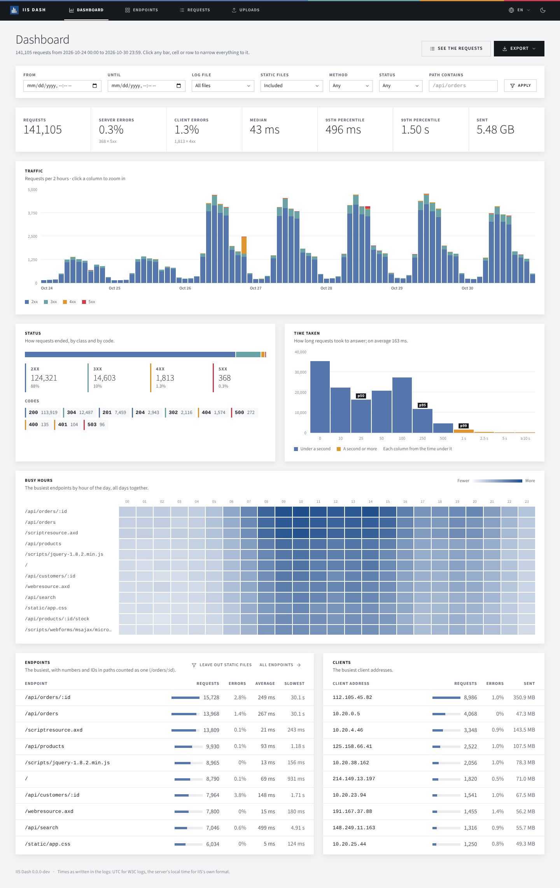
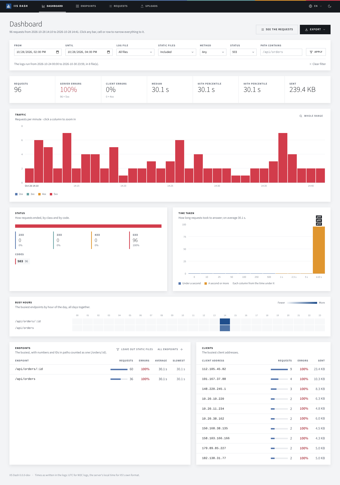
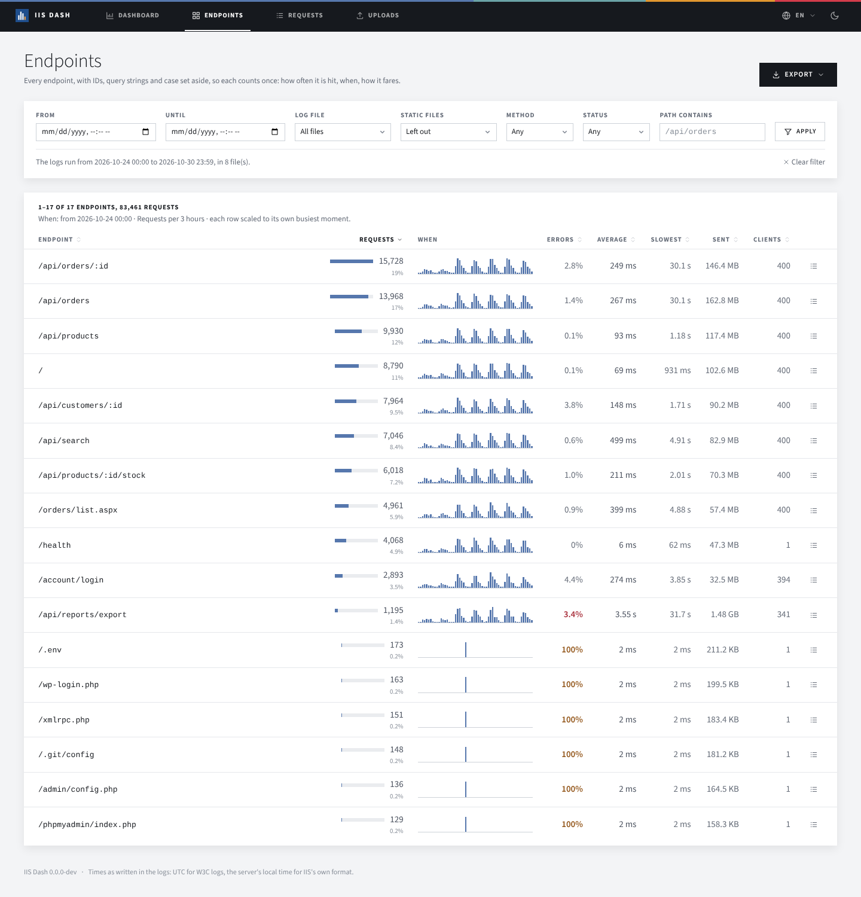
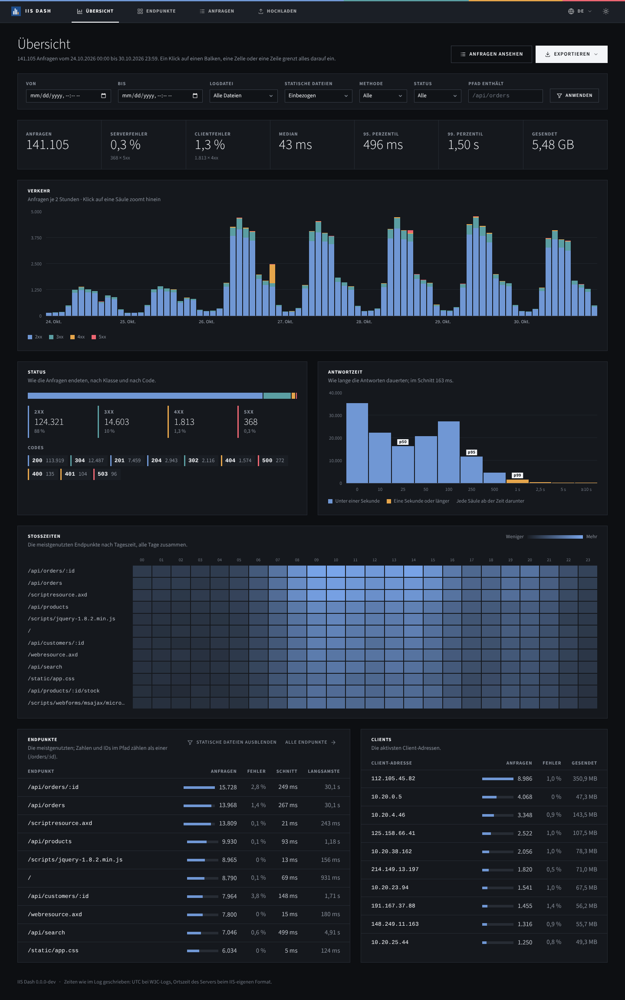
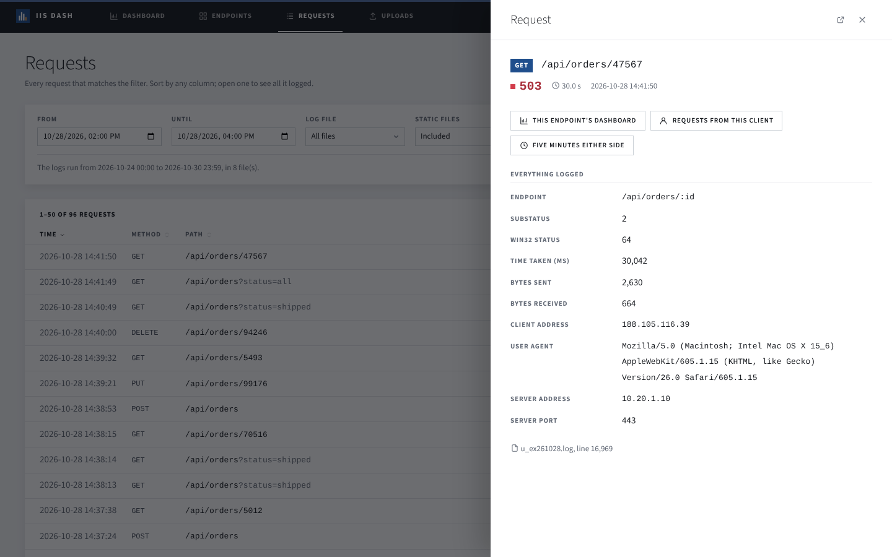
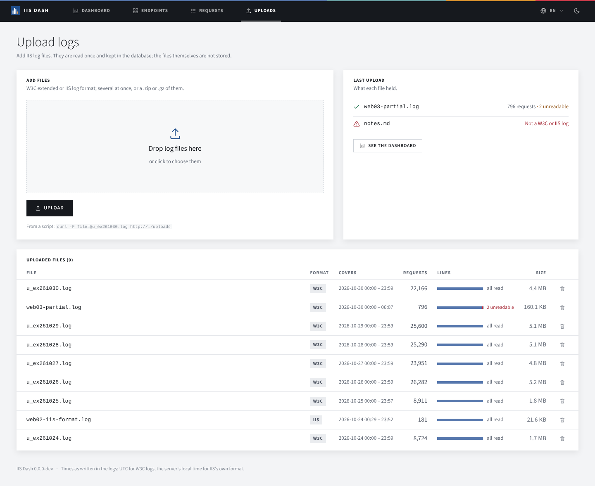
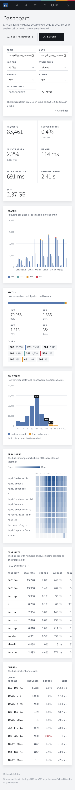

# IIS Dash

Upload IIS log files and see what your sites did: traffic over time, how requests ended, how long they took, which
endpoints are busy and when, and who is calling. Every bar, cell and row narrows the whole view to it. English and
German, light and dark.

One native executable for Linux or Windows (no .NET install needed, nothing next to it), or a container image.



| | |
| --- | --- |
|  |  |
|  |  |
|  |  |

## Run it

**Windows or Linux:** download `iis-dash-<version>-win-x64.exe` or `-linux-x64` from the
[releases](../../releases) and run it. It listens on <http://localhost:5080> and keeps its database in `data/` under
the folder you start it from.

```bash
./iis-dash-1.0.0-linux-x64 --urls http://0.0.0.0:8080 --data /var/lib/iis-dash
```

**Container:**

```bash
docker run -d -p 8080:8080 -v iis-dash-data:/home/app ghcr.io/leonio/iis-dash
```

The image runs as its unprivileged `app` user and keeps the database in its home folder, `/home/app`: mount a volume
there (a named volume takes the folder's owner; a host folder must be writable by UID 1654). `/healthz` answers `ok`.

**From source:** the .NET 10 SDK.

```bash
dotnet run --project src/IisDash
```

### Settings

| | Environment | Command line | Default |
| --- | --- | --- | --- |
| Database folder | `IISDASH_DATA` | `--data` | `data` (the image: `/home/app`) |
| Largest log file accepted | `IISDASH_MAX_FILE_MB` | `--max-file-mb` | 512 |
| Where it listens | `ASPNETCORE_URLS`, `ASPNETCORE_HTTP_PORTS` | `--urls` | `http://localhost:5080` (the image: port 8080) |

There is no sign-in: put it behind your reverse proxy's if it needs one.

## Getting logs in

On **Uploads**, drop files or pick them: W3C extended (IIS's default) or IIS's own log format, several at once, or a
`.zip` (every file in it, in any folder) or `.gz`. Each file is checked as soon as it is picked, and after the upload
the page says what each held, with any lines that could not be read one click away.

A file with the same name as one already uploaded replaces it, so uploading today's log again brings it up to date.
From a script, or a scheduled task on the web server:

```bash
curl -F file=@C:/inetpub/logs/LogFiles/W3SVC1/u_ex261030.log http://iis-dash:8080/uploads
```

which answers in text, one line per file (`u_ex261030.log  ingested  W3C  22406 requests  0 unreadable`), and with
status 422 if any file was not read.

Times are kept as written in the log: UTC for W3C logs, the server's local time for IIS's own format.

## What it shows

Everything follows the filter at the top, which lives in the URL, so any view can be bookmarked or sent to someone.

- **Dashboard**: the key figures (requests, server and client error rates, median, 95th and 99th percentile, data
  sent); traffic stacked by status class, in buckets from a minute to a week depending on the range (click a column to
  zoom in); status classes and codes; a latency histogram with the percentiles marked; the busiest endpoints by hour of
  the day; the busiest endpoints and clients.
- **Endpoints**: every endpoint, sortable by requests, errors, speed, data sent or clients, each with a timeline of
  when it is hit, scaled to its own busiest moment.
- **Requests**: every matching request, sorted over all of them (not just the page), each opening in a side panel
  with everything logged and links to the requests like it.
- **Export**: the figures behind every chart, or the matching requests, as an Excel workbook.

**Endpoints** are paths with the parts that vary set aside, so each counts once: numbers and GUIDs become `:id`
(`/orders/42` → `/orders/:id`), the query string is dropped, and the case is ignored, as IIS ignores it
(`/Orders/List.aspx` and `/orders/list.aspx` are one).

**Static files**: scripts, style sheets, images, fonts and source maps, and ASP.NET's `ScriptResource.axd` and
`WebResource.axd`, which Web Forms pages load their scripts through (often uncached, several per page view), are
recognised when a log is read ([`StaticFiles.cs`](src/IisDash/Features/Uploads/Parsing/StaticFiles.cs)). The filter's
**Static files** field leaves them out, so the dashboard and the endpoints list show what people and programs actually
asked for, or shows nothing else, to see which assets are fetched most.

## How it is built

ASP.NET Core minimal APIs render the pages on the server with [RazorSlices](https://github.com/DamianEdwards/RazorSlices);
[htmx 4](https://four.htmx.org) moves between them (links and the filter morph the new page into the old one, so the
scroll position and the header stay, and the address bar follows); [UIkit](https://getuikit.com) 3 for the components,
themed like Spec Coach in agent-framework-sandbox. The charts are plain HTML and CSS drawn on the server: no chart
library, no JavaScript beyond htmx, UIkit and [`app.js`](src/IisDash/Static/app.js) (the theme switch, the side panel,
the drop zone). UIkit, htmx and the font are embedded in the executable, so the app works offline.

**SQLite**, plain SQL ([`Db.cs`](src/IisDash/Shared/Data/Db.cs), [`schema.sql`](src/IisDash/Shared/Data/schema.sql)): every
figure is an aggregate computed in the database, so a page never loads requests into memory, and an upload streams
through the parser into one prepared INSERT, about 40,000 requests a second. On Linux, SQLite is linked into the
executable; on Windows it is the SQLite that ships with Windows (`winsqlite3`), so either is one file.

**Native AOT**: `PublishAot` is on in [`IisDash.csproj`](src/IisDash/IisDash.csproj), so every build runs the AOT and
trim analyzers and anything that would break the native build fails the ordinary one. Native compilation does not cross
operating systems: CI builds the Linux executable on Linux (Ubuntu 22.04, for an older glibc) and the Windows one on
Windows. The Excel export is a small hand-written writer ([`XlsxWriter.cs`](src/IisDash/Features/Export/XlsxWriter.cs)),
as spreadsheet libraries need reflection.

**Container**: `dotnet publish -t:PublishContainer`, no Dockerfile. The SDK puts the native executable on
`mcr.microsoft.com/dotnet/runtime-deps:10.0-noble-chiseled` (no shell, no package manager, a non-root user): about
14 MB to download, 45 MB on disk.

```bash
dotnet publish src/IisDash -c Release -r linux-x64                          # bin/Release/net10.0/linux-x64/publish/iis-dash
dotnet publish src/IisDash -c Release -r linux-x64 -t:PublishContainer      # into the local Docker
```

### Where things are

Vertical slices: each feature is one folder with its routes, its SQL and its pages.

| | |
| --- | --- |
| [`Features/Dashboard`](src/IisDash/Features/Dashboard) | the dashboard: its queries, the charts' arithmetic, a slice per panel |
| [`Features/Endpoints`](src/IisDash/Features/Endpoints) | the endpoints list with its timelines |
| [`Features/Requests`](src/IisDash/Features/Requests) | the requests list and one request |
| [`Features/Uploads`](src/IisDash/Features/Uploads) | uploading, the parsers ([`Parsing`](src/IisDash/Features/Uploads/Parsing)), ingestion |
| [`Features/Export`](src/IisDash/Features/Export) | the Excel workbooks |
| [`Shared/Filters`](src/IisDash/Shared/Filters) | the filter: from the URL, to SQL, the filter bar |
| [`Shared/Web`](src/IisDash/Shared/Web) | the layout, texts ([`I18n.cs`](src/IisDash/Shared/Web/I18n.cs), [`Locales`](src/IisDash/Locales)), number and date formats |
| [`Static`](src/IisDash/Static) | the theme (UIkit's, from Spec Coach), the app's CSS and JavaScript, vendored UIkit, htmx and font |

Adding a language is adding its `Locales/<code>.json` with the same keys as `en.json` (a test checks), including its
number and date conventions (`format.*`).

## Tests and sample data

```bash
dotnet test
```

Unit tests for the parsers, endpoint folding, static files, the filter's SQL, the formats in both languages, the texts
and the Excel writer; and the app in memory, end to end: uploads (a zip, a file that is not a log, a replaced file), the
dashboard and its drill-downs, sorting, a request, both exports, deleting, the endpoints list with static files left
out, the plain-text answer for scripts, and German.

[`tools/gen-logdata.cs`](tools/gen-logdata.cs) writes a week of realistic logs, as in the screenshots: a working-day
rhythm, quieter weekends, an older Web Forms section loading its scripts through `ScriptResource.axd`, a scanner, a slow
report export and an incident on the fifth day.

```bash
dotnet run tools/gen-logdata.cs                     # 7 days of W3C logs into ./sample-logs
dotnet run tools/gen-logdata.cs -- iis 1 2000 out   # 1 day in IIS's own format into ./out
```
